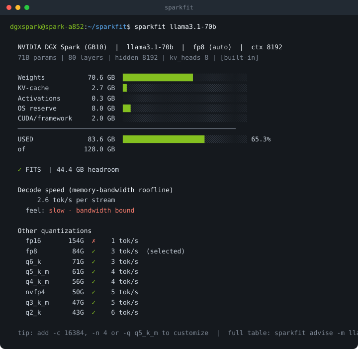

<p align="center">
  <picture>
    <source media="(prefers-color-scheme: dark)" srcset="assets/logo-dark.svg">
    
  </picture>
</p>

<p align="center">
  <a href="https://github.com/engineering87/sparkfit/actions/workflows/ci.yml"></a>
  <a href="LICENSE"></a>
  
  <a href="https://github.com/astral-sh/ruff"></a>
  
</p>

**LLM memory capacity planner for the NVIDIA DGX Spark (GB10).**

Catalog tools answer "does this model fit on my hardware, yes or no?" on generic
GPUs. sparkfit treats the DGX Spark as what it is: a 128 GB unified-memory machine
that is, above all, memory-bandwidth bound (273 GB/s shared between CPU and GPU).
So it answers three questions a fit/no-fit catalog does not:

1. Unified-memory budgeting. How the 128 GB is really split between weights,
   KV-cache, activations, the CUDA/serving framework, and the slice you must leave
   for the Grace CPU side and the OS.
2. Will it actually be fast? A memory-bandwidth roofline estimate of decode
   throughput (tokens/s). On Spark, "it fits" and "it is usable" are two different
   things, and bandwidth, not capacity, is the limit.
3. How to make it fit or scale. A quantization advisor (the highest-quality format
   that fits with a safety margin) and a concurrency planner (how many parallel
   streams or model replicas fit at once).

Pure Python standard library (3.10+). No dependencies.

## Install

sparkfit is a CLI, so [pipx](https://pipx.pypa.io/) is the cleanest way to install
it (isolated environment, global `sparkfit` command):

```bash
pipx install sparkfit        # or: pip install sparkfit
```

To get the latest unreleased code, install from source instead:

```bash
pipx install git+https://github.com/engineering87/sparkfit.git
```

On a fresh DGX Spark (DGX OS) you may need pipx first. Note that a plain
system-wide `pip install` is blocked by PEP 668 on these systems:

```bash
sudo apt install -y pipx && pipx ensurepath   # then restart the shell
```

Plain pip works inside a virtual environment:

```bash
python3 -m venv .venv && . .venv/bin/activate
pip install git+https://github.com/engineering87/sparkfit.git
```

Or clone and run the single file, no install needed (handy for pasting onto a
fresh DGX Spark):

```bash
git clone https://github.com/engineering87/sparkfit.git
cd sparkfit
python src/sparkfit.py llama3.1-70b  # or: ./sparkfit llama3.1-70b
```

## Quick start

Pass just a model name and sparkfit does the rest: it auto-selects the
highest-quality quantization that fits with margin, a typical context (8192), and
shows the budget, the verdict, estimated tok/s, and the alternatives.

```bash
sparkfit llama3.1-70b          # built-in catalog id
sparkfit "llama 70"            # partial match -> llama3.1-70b
sparkfit 72b                   # even a fragment works
sparkfit Qwen/Qwen2.5-7B       # Hugging Face id -> reads params online
sparkfit /models/my-model/config.json   # a local config.json (file or dir)
```

<p align="center">
  
</p>

Override any default: `sparkfit qwen2.5-72b -c 16384 -n 4 -q q5_k_m`.

If the model's `config.json` declares its quantization (`quantization_config`),
sparkfit uses it instead of guessing: FP8, GPTQ, AWQ, bitsandbytes,
compressed-tensors, and the Blackwell-native 4-bit formats MXFP4 (gpt-oss) and
NVFP4 (ModelOpt, compressed-tensors) are recognized. An explicit `-q` still wins.

### Co-serving several models

On a unified-memory box you often run more than one model at once (say a
generator plus an embedding and a reranker). `serve` sums their footprints
against the 128 GB and splits the shared 273 GB/s across the models decoding at
the same time, so you see both what co-resides and how much each slows the
others down:

```bash
sparkfit serve qwen2.5-7b:fp8:8192 gemma2-9b:fp8:4096 llama3.2-3b:fp8:2048
```

Each token is `NAME[:quant[:context]]`, where `NAME` can be a catalog id, a Hugging
Face id, or a local model path (Windows paths such as `C:\models\x:fp8` work too).
Quant falls back to the one detected from the model's config, then to `-q`;
context falls back to `-c`. `-b` and `-n` set the streams served by each model,
which grow its KV-cache and split its decode speed. As a worst case, N models
decoding at once each get about their solo speed divided by N; idle or bursty
models free their share.

### Clustering several Sparks

`cluster` plans one model across several DGX Spark nodes linked by the ConnectX-7
fabric (200 Gb/s, about 25 GB/s, over 10x slower than on-node memory). Weights,
KV-cache and activations split evenly across the nodes, so a model too big for one
box can fit on several:

```bash
sparkfit cluster deepseek-r1 -N 4 -q q4_k_m            # pipeline parallel (default)
sparkfit cluster llama3.1-70b -N 2 --parallelism tp    # tensor parallel, one stream
```

Throughput scales sub-linearly: each extra node adds `--scaling` (0..1, default
0.5) of one node's speed, reduced in proportion when `--fabric-gbps` is below the
200 Gb/s reference. A faster fabric does not raise it further, so N nodes never
report more than N times one node. Pipeline parallelism reports aggregate
throughput; tensor parallelism reports single-stream speed.

### `--live`: plan against the memory free right now

Run on the Spark, `--live` budgets against currently-free memory (read from
`/proc/meminfo` and `nvidia-smi`, converted to decimal GB) instead of the
theoretical 128 GB, and waives
the OS reserve, since the free figure already excludes the OS and running
processes. Useful when you already have models or containers loaded and want to
know what you can still add.

```bash
sparkfit llama3.1-8b --live
sparkfit qwen2.5-32b --live
```

## Commands

| Command | What it does |
|---|---|
| *(none)* | Pass just a model and get a one-shot smart report with sensible defaults |
| `plan`   | Full unified-memory budget plus a decode-speed roofline for one configuration |
| `advise` | Recommends the highest-quality quant that fits with a 10% margin |
| `fit`    | Scans the model DB for what fits; `--concurrency-scan` finds max parallel streams |
| `serve`  | Plans several models co-served at once: shared memory and shared bandwidth |
| `cluster`| Plans one model across several Spark nodes: combined memory and the inter-node fabric |
| `doctor` | Calibrates efficiency to your device from a measured tok/s and saves it |
| `scan`   | Live snapshot when run on the Spark: memory, GPU temperature and thermal throttling |
| `models` | Lists the built-in model database |

Every command supports `--json` for machine-readable output (CI, dashboards,
scripting).

### Key flags

`-q/--quant` (default `q4_k_m` for `plan`, `advise`, `fit`; for `serve`, `cluster`
and `doctor` the quant detected from the model's config, else `q4_k_m`; auto in
quick mode), `-c/--context`, `-b/--batch`, `-n/--concurrency`,
`--kv-dtype {fp16,bf16,fp8,int8,q4}`, `--os-reserve` (GB, default 8),
`--framework` (GB, default 2), `--total-mem`, `--bandwidth`, `--efficiency` (default 0.70),
`--engine {vllm,llama.cpp,ollama}` (per-engine efficiency and step-overhead preset),
`--step-overhead-ms` (default 4), `--prompt-tokens`,
`--mfu`, `--compute-tflops`, `--live`, `--json`.
For models not in the DB: `--params --active --layers --hidden --kv-heads --head-dim`.

Values are checked before planning: `--efficiency` and `--mfu` must be in (0, 1],
`--os-reserve`, `--framework` and `--step-overhead-ms` at least 0, and `--total-mem`, `--bandwidth`,
`--compute-tflops` and `--weights-gb` above 0. This also applies to values coming
from `SPARKFIT_*` variables or the config file.

## Methodology

All assumptions are explicit constants near the top of `src/sparkfit.py` and can be
overridden from the command line. Everything below is plain arithmetic, not a
benchmark, so you can audit it and change any assumption.

### Memory budget

```
streams      = batch * concurrency
weights      = params_B * 1e9 * bits_per_weight / 8
kv_cache     = kv_per_token * context * streams
activations  = streams * context * hidden * 2 * 2      # two fp16 work buffers
used         = weights + kv_cache + activations + os_reserve + framework
fits         = used <= total_memory
```

`bits_per_weight` comes from the `QUANT_BITS` table, which uses the real on-disk
width of each format (for example `q4_k_m` is 4.85 bits, not 4.0; `fp16` is 16).
Sizes use decimal GB (1e9), matching how the 128 GB is advertised.

### KV-cache per token

Standard attention (MHA, or grouped-query GQA):

```
kv_per_token = 2 * layers * kv_heads * head_dim * dtype_bytes
```

The 2 is for K and V; GQA is captured by `kv_heads` being smaller than the number
of attention heads. `dtype_bytes` is 2 for fp16, 1 for fp8/int8, 0.5 for 4-bit.

Multi-head Latent Attention (MLA, DeepSeek V2/V3/R1) stores one compressed latent
per layer instead of per-head K and V:

```
kv_per_token = layers * (kv_lora_rank + qk_rope_head_dim) * dtype_bytes
```

This is much smaller. For DeepSeek-R1 at 8k context it is about 0.6 GB, versus tens
of GB for a naive per-head estimate.

Hybrid models (Qwen3.5, Jamba, ...) mix linear/SSM layers with periodic full
attention; only the `full_attention` layers keep a growing cache, so just those
are counted (read from `layer_types` or `full_attention_interval`).

Sliding-window attention (Mistral, Gemma, ...) caps the resident cache at the
window size, so very long contexts do not keep growing it.

### Decode speed (roofline)

Token generation is memory-bound: each step reads the active weights once plus the
resident KV-cache of every concurrent stream. With a fraction `eff` of peak
bandwidth actually reached:

```
streams           = batch * concurrency
bytes_per_step    = active_weights + kv_per_token * context * streams
step_time         = bytes_per_step / (bandwidth * eff) + step_overhead
tok_s_aggregate   = streams / step_time
tok_s_per_stream  = tok_s_aggregate / streams
```

Defaults: `bandwidth` 273 GB/s, `eff` 0.70, `step_overhead` 4 ms. Weights are read
once per step but the KV-cache is read for all streams, so adding concurrency
raises aggregate throughput while each stream gets slower.

`step_overhead` is the fixed cost every step pays whatever the model size: kernel
launches, sampling, scheduling and MoE routing. For a 70B model it is noise next
to a ~300 ms step, but for a model with ~3B active parameters, whose step streams
only a couple of GB in ~10 ms, it is a large share; without it those models were
estimated up to 2x too fast. `--engine` sets it with the efficiency (vLLM 4 ms,
llama.cpp 1 ms, ollama 2 ms: llama.cpp numbers usually come from `llama-bench`,
which leaves out server overhead). Override it with `--step-overhead-ms` or
`SPARKFIT_STEP_MS`.

For a Mixture-of-Experts, `active_weights` is what the batch actually touches. A
single stream reads only its active parameters, which is why a large MoE can be far
faster than its total size suggests. With many streams, different tokens are
routed to different experts, so each step reads the always-on part (attention,
embeddings, shared experts) plus every expert picked by at least one token. With E
routed experts, top-k routing and B tokens per step:

```
experts_touched  = E * (1 - (1 - k/E)^B)
active_weights   = always_on + experts_touched * params_per_expert
```

For gpt-oss-120b (128 experts, top-4), 64 concurrent streams already touch about
87% of the experts, so batched MoE serving is much closer to a dense model of the
same total size than single-stream decode suggests. This assumes uniform routing;
real routing skew touches somewhat fewer experts. Built-in MoE models carry their
expert counts, Hugging Face configs provide them, and for a custom model pass
`--experts` and `--top-k`.

Prefill (processing the prompt) is instead compute-bound for long prompts and
bandwidth-bound (stream the weights once) for short ones, so the time to first
token is modeled as `max(compute_time, memory_time)`:

```
compute_time = (2 * active_params * prompt + 2 * layers * prompt^2 * hidden)
               / (bf16_tflops * precision_mult * moe_factor * mfu)
memory_time  = weights_bytes / (bandwidth * eff)
ttft         = max(compute_time, memory_time)
```

- `bf16_tflops` is 100, the dense BF16 matmul throughput measured on GB10
  (MAMF/GEMM benchmarks report about 99 to 100 TFLOPS, below the ~125 theoretical).
- `precision_mult` is 2 for fp8 and 3.5 for fp4 (measured: about 200 and 350
  TFLOPS), and 1 otherwise. It is also 1 with `--engine llama.cpp` or `ollama`,
  which dequantize weights and compute in 16-bit.
- `moe_factor` is 0.5 for MoE models, whose prefill runs many small per-expert
  GEMMs that reach a lower fraction of peak than one large dense GEMM.
- `mfu` defaults to 0.30.

With these defaults, gpt-oss-120b on llama.cpp prefills about 1,400 tokens/s,
against about 1,700 measured on GB10. Calibrate `mfu` from your own measurement
with `sparkfit doctor --measured-ttft` (see below), or set it with `--mfu`;
`--compute-tflops` overrides the BF16 base and `--prompt-tokens` sizes the prompt.

### Reserves and parameter estimation

On unified memory the CPU and GPU share one pool, so by default 8 GB (OS/DGX plus
the Grace side) and 2 GB (CUDA context plus serving framework) are held back. Both
are adjustable; `--live` sets the OS reserve to 0 because the live-free figure
already excludes it.

For Hugging Face auto-fetch, parameters are estimated from `config.json` by summing
embeddings, attention projections, and the MLP or expert layers (including MLA
projections and DeepSeek fine-grained MoE). Validated against real configs:
Qwen2.5-7B gives 7.62B (actual 7.61B), Mixtral-8x7B gives 46.7B total and 12.9B
active, and DeepSeek-V3 gives about 671B total and 37B active.

When you point at a local model directory, sparkfit reads the real on-disk weight
size (from the safetensors index or the files) and uses it instead of the
estimate, which is exact even for hybrid, multimodal, or mixed-precision models.
You can also set it manually with `--weights-gb`.

### Calibrating to your device

The defaults (70% bandwidth efficiency, 8 GB OS reserve, 2 GB framework) are
conservative starting points. If you measure real numbers on your Spark, plug them
in per run with `--efficiency`, `--bandwidth`, `--os-reserve`, `--framework`, or set
them once via environment variables so they stick:

```bash
export SPARKFIT_EFFICIENCY=0.6     # measured decode tok/s divided by the roofline
export SPARKFIT_OS_RESERVE=10
sparkfit llama3.1-8b
```

To calibrate efficiency, run a known model on your serving stack, note the real
decode tok/s, and let `sparkfit doctor` do the arithmetic and save it:

```bash
sparkfit doctor --measured-tok-s 6.8 --weights-gb 35.9 --save   # -> efficiency ~0.92
sparkfit doctor --engine vllm --save                            # or start from a preset
```

Prefill is calibrated the same way from a measured time-to-first-token. Use a long
prompt, so the measurement is compute-bound rather than limited by reading the
weights once; `doctor` refuses to save an MFU taken at that bandwidth floor:

```bash
sparkfit doctor --measured-ttft 4.2 -m llama3.1-8b -q fp8 --engine vllm \
  --prompt-tokens 16384 --save                                  # -> prefill MFU ~0.40
```

Both measurements can be passed in one run.

`doctor` writes the value to `~/.sparkfitrc` (override with `$SPARKFIT_CONFIG`), which
every command reads as a default. Precedence is flag > environment variable > config
file > built-in default, so an explicit `--efficiency` on a single run always wins.
The file holds `key = value` lines; the recognized keys are `efficiency`,
`bandwidth`, `os_reserve`, `framework`, `mfu`, `tflops` and `step_ms`.

A robust, architecture-independent shortcut is
`efficiency ~= measured_tok_s * weights_GB / 273`, where `weights_GB` is the
on-disk size of the weight files. Measured example: a DGX Spark serving an FP8
model under vLLM (no other load) reached 6.8 tok/s against 35.9 GB of weights,
i.e. about 0.89 efficiency (6.8 * 35.9 / 273), well above the conservative 0.70
default. `doctor` also subtracts the fixed step overhead from each measured step
before dividing, so for the same measurement it reports about 0.92; the
difference matters only for small, fast models.

### Validation on a real DGX Spark

Measured on a DGX Spark serving FP8 models with vLLM:

- Bandwidth efficiency: a single stream reached 6.8 tok/s on 35.9 GB of
  weights, about 0.85 to 0.89 of the 273 GB/s roofline (the 0.70 default is
  conservative).
- Concurrency: aggregate throughput scaled almost linearly to 8 parallel
  streams (6.8, 13.5, 26.4, 51.9 tok/s; per-stream 6.8 down to 6.5), matching
  sparkfit's batched-decode model within about 5%.
- Contention: co-serving a second model (a 4B embedding model under load) on
  the same unified memory cut the generator from 6.8 to 3.8 tok/s. Single-model
  commands assume a model gets the full 273 GB/s; to plan co-serving, use
  `sparkfit serve`, which splits the bandwidth across the models decoding at once.

These are capacity-planning estimates, not measurements. For exact numbers,
cross-check with `sparkfit scan` on the real machine.

## DGX Spark (GB10) reference

128 GB unified LPDDR5x, 273 GB/s shared CPU+GPU bandwidth, Blackwell GPU with FP4
(about 1 PFLOP / 1000 TOPS), 20-core Grace Arm CPU. The 273 GB/s bandwidth is the
dominant constraint for token generation.

## Roadmap

- Local cache of fetched Hugging Face configs.
- Expanded built-in model database.
- Optional Go single-binary port.

## Contributing

See [CONTRIBUTING.md](CONTRIBUTING.md) and the [Code of Conduct](CODE_OF_CONDUCT.md).
Issues and pull requests are welcome.

## License

[MIT](LICENSE).
